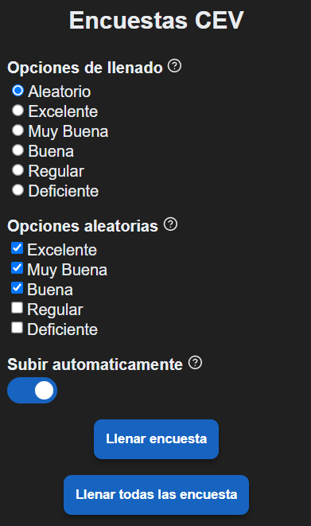

# 🎓 Auto Completar Encuestas CEV (SIASE)

Extensión para navegadores basados en Chromium diseñada para autocompletar de forma rápida y sencilla las encuestas de evaluación docente (CEV) en el portal SIASE, desbloqueando el acceso a tus trámites y calificaciones sin perder tiempo.

## ✨ Características

* **Llenado automático total:** Completa todas las preguntas de la encuesta con un solo clic.
* **Modos de respuesta flexibles:** Elige entre responder de manera completamente aleatoria o seleccionar una opción fija para todas las preguntas (ej. "Totalmente de acuerdo").
* **Filtro de respuestas aleatorias:** Personaliza qué opciones entran en el sorteo aleatorio (por ejemplo, evitar calificaciones bajas o muy altas).
* **Procesamiento continuo:** Avanza y completa múltiples encuestas pendientes de forma automatizada.

## 📸 Capturas de pantalla

## 🚀 Instalación (Modo Desarrollador)

Dado que esta extensión no se encuentra en la Chrome Web Store, puedes instalarla manualmente siguiendo estos pasos:

1. Descarga este repositorio haciendo clic en **Code > Download ZIP** y descomprime el archivo (o clónalo usando `git clone`).
2. Abre tu navegador (Chrome, Edge, Brave, etc.) y ve a la página de extensiones escribiendo en la barra de direcciones:
   * Chrome: `chrome://extensions/`
   * Edge: `edge://extensions/`
   * Brave: `brave://extensions/`
3. Activa el **Modo de desarrollador**.
4. Haz clic en el botón **Cargar descomprimida**.
5. Selecciona la carpeta raíz donde descomprimiste el proyecto.

## 🛠️ Uso

1. Inicia sesión en https://www.uanl.mx/enlinea/ y dirígete al apartado de Encuestas CEV.
2. Haz clic en el ícono de la extensión en la parte superior de tu navegador.
3. Configura tu modo preferido (respuesta fija o aleatoria con filtros).
4. Presiona el botón de llnear encuesta o llenar todas las encuestas.

## ⚠️ Aviso / Disclaimer

Este proyecto fue creado únicamente con fines educativos y de ahorro de tiempo para estudiantes. Úsalo bajo tu propia responsabilidad. No está afiliado, asociado ni respaldado oficialmente por la universidad ni por los desarrolladores del sistema SIASE.

Esta extensión no recopila ni envia NINGUN dato a servidores de terceros. Todo se ejecuta de manera local y los datos quedan entre tu dispositivo y los servidores de la UANL.